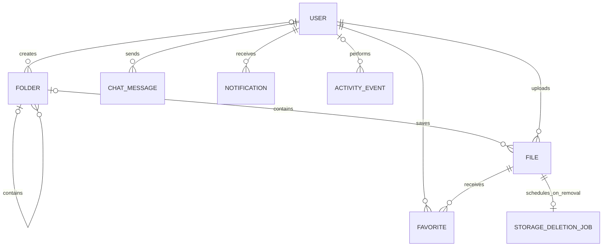

# WeFiles Django rebuild — approved implementation plan

Status: approved by the user, with the product renamed to **WeFiles**.
Implementation is directly in `WeFiles/`; see the root README and verification report for
actual delivered behavior and checks. The original Liki reference is preserved.

## 1. Assumptions and improved requirements

### Reference application and assumptions

The reference is the checked-in React/TypeScript/Supabase application in
`legacy/` relative to this repository. Its pages, components, types, and SQL
migrations establish the following behavior:

- **Purpose:** Liki gives an approved community a private, shared file vault
  and a single crew chat, with administrators controlling membership.
- **Users:** a small team, club, or community; members and administrators.
- **Existing features:** email registration and verification, login, password
  recovery, approval statuses, dashboard, nested shared folders, file upload
  and download, username editing, administrator approvals and role changes,
  global realtime chat, and light/dark themes.
- **Access:** new accounts are pending. Only approved members may access the
  vault and chat. All approved members see the same files; this is one
  workspace, rather than a multi-tenant product.
- **Existing limits:** uploads are limited to 50 MiB; messages to 2,000
  characters. Members create folders and upload/download files. Only admins
  delete files and empty folders. Existing file metadata is immutable.
- **Proposed change:** admins may rename files, edit descriptions, and move
  files/folders. File bytes remain immutable; a new upload creates a new file.
- **Rebuild location:** directly in `WeFiles/`, with feature apps such as
  `accounts/` beside `manage.py` and the preserved `legacy/` reference. The existing application remains available as a reference.
- **Migration assumption:** build a fresh database with optional demo data.
  Live Supabase records, passwords, and storage objects are not available in
  the checkout. A live-data import needs a separate, explicit migration plan;
  no password migration or production cutover is assumed.
- **Chat change:** HTMX polling every five seconds provides near-realtime
  updates without requiring WebSockets. This is a deliberate change from
  Supabase realtime, suitable for the assumed community size.
- **Deployment assumption:** deliver runnable local code and Docker assets.
  Hosting credentials, domain, mail provider, and monitoring credentials must
  be supplied for a live deployment.

### Observed weaknesses to address

These are source-review findings, not results of testing a live deployment.

- The vault fetches all file and folder records and filters in the browser;
  use indexed server-side queries and pagination.
- The chat initially requests the first 200 messages in ascending order;
  show the latest messages with a route for older history.
- Some download errors use browser alerts; use consistent inline messages
  with retry actions and accessible status announcements.
- Pending and rejected routes render plain paragraphs; provide useful status
  screens with navigation, verification/resend guidance, and logout.
- Folder errors expose instructions to run SQL migrations to end users;
  log implementation details and show friendly, actionable errors.
- File records and object storage are updated separately; use explicit
  services, failure compensation, and retryable storage cleanup.
- Registration expects a username, but the checked-in provisioning SQL does
  not create a username field; use a single, migrated custom User model.
- Persistent chat competes with the main content on smaller screens; give
  chat a dedicated destination and an optional compact desktop panel.

### Functional requirements, stories, and acceptance criteria

All criteria below are planned and must be verified during implementation.
"Approved" below means authenticated, email-verified, active, and approved.

| Priority | Feature | User story | Acceptance criteria |
| --- | --- | --- | --- |
| Must | Registration and email verification | As a visitor, I want to register and verify my email so that I can request trusted access. | Unique email and username are enforced case-insensitively; username is 3–20 letters, digits, or underscores; Django password validators run; account starts as member/pending; expiring signed verification links and rate-limited resend work; verification alone grants no vault access. |
| Must | Login and logout | As a member, I want secure sign-in and sign-out so that my account stays private. | Email/password login uses Django sessions; invalid credentials receive a generic error; login is throttled; redirects stay on allowed hosts; logout requires CSRF-protected POST; status is checked on every private request. |
| Must | Password recovery/change | As an account holder, I want to reset or change my password so that I can recover and protect my account. | Reset requests return the same confirmation for known/unknown email addresses; Django expiring, single-use reset tokens work; password validation runs; authenticated change flow works; SMTP failures are logged and shown safely. |
| Must | Approval and access status | As an administrator, I want to approve, reject, or disable registrations so that access stays controlled. | Pending/rejected/disabled/unverified users cannot access files, downloads, chat, stats, or exports, including direct URLs; they can see their status and manage/delete their own account; a status change affects an existing session on its next request. |
| Must | Profile management | As a member, I want to update my username and display name so that people recognize me. | Only safe profile fields are editable; unique usernames are validated server-side; role/status/verification are never accepted from profile forms; email is displayed read-only; password change and deletion are linked. |
| Must | File CRUD | As an approved member, I want to upload, browse, and download files so that I can share resources. | Server validates file size and safe display names; UUID storage keys prevent path traversal/collisions; all downloads require authorization and use attachment disposition plus nosniff; members cannot alter/delete files; admins edit name/description/folder and confirm deletion; missing objects produce a friendly error. |
| Must | Folder CRUD | As an approved member, I want nested folders so that shared files stay organized. | Members create/browse folders; sibling names are unique case-insensitively, including at root; breadcrumbs work; admins rename/move folders; cycles and invalid names are rejected; only empty folders can be deleted, enforced server-side. |
| Must | Search, filters, sorting, pagination | As a member, I want to narrow the vault so that I can quickly find a file. | Search name/description; filter folder, type, uploader, and saved state; sort name/date/size using an allowlist; 25 files per page; preserve parameters across pagination; invalid filters do not crash; ordinary browsing shows immediate children and search can cover the whole vault. |
| Must | Roles and permissions | As an administrator, I want clear permissions so that membership cannot be escalated. | Application roles are member/admin; staff and superuser flags remain separate Django maintenance privileges; admin actions are enforced in services/views; administrators may change any workspace role, including their own and superusers’ application roles; self status changes remain blocked; the last approved administrator is protected; registration/profile requests cannot assign privileges. |
| Must | Crew chat | As a member, I want a shared conversation so that I can coordinate with the group. | Latest 50 messages load chronologically; older messages are paginated; HTMX refreshes every five seconds while visible; sending works without JS; whitespace-only and over-2,000-character messages fail; sender comes from the session; messages are escaped; posting is throttled. |
| Must | Dashboard | As a member, I want useful recent activity so that I can resume work quickly. | Accurate shared-file/storage/member counts, recent files/chat, and direct upload action are available; admin-only metrics remain restricted; empty states guide the next action. |
| Must | Account deletion and privacy | As an account holder, I want to delete my account so that I control my personal data. | Password re-entry and an explicit confirmation are required; own uploads, messages, notifications, and favorites are removed; storage deletion is retried on failure; shared folders survive with a null creator; audit actor references are anonymized; active sessions lose access; the last approved administrator must appoint a replacement first. The confirmation explains that the member's shared uploads will disappear. |
| Should | In-app notifications | As a member, I want relevant updates so that I know when my access changes. | Registration creates an admin notification; approval/rejection and role/status changes create recipient notifications; users see only their own notifications; unread count and mark-one/all-read use safe POSTs; notification links recheck destination permissions. |
| Should | Saved files | As a member, I want to save useful files so that I can find them again. | Toggle save with POST; one favorite per user/file is enforced in the database; saved filter and empty state work; deleted files remove associated favorites; HTML fallback works. |
| Should | Administrator dashboard | As an administrator, I want usage stats and a member queue so that I can manage the community. | Member/status counts, file count/storage totals, recent activity, searchable paginated member list, approvals, disable/restore, and role changes are available; invalid/stale actions fail clearly; Django admin supports maintenance. |
| Should | Consistent validation and feedback | As a user, I want clear feedback so that I can fix mistakes and trust actions. | Field errors are associated with labels/inputs; non-field errors are announced; successful mutations confirm the result; HTMX indicates busy state, prevents double submits, and preserves form input on errors. |
| Nice, included | Dark mode | As a user, I want a comfortable theme so that I can work in different lighting. | Light/dark/system modes use shared tokens; choice persists locally without sending analytics; both themes pass contrast checks; reduced motion is respected. |
| Nice, included | CSV export | As a member, I want a file inventory so that I can review metadata offline. | Export respects the current authorized filters; includes metadata only, streams bounded query batches, and neutralizes spreadsheet formula injection; no storage keys or personal email list are exported. |
| Nice, included | Activity history | As an administrator, I want a record of important changes so that I can investigate issues. | Successful membership/file/folder actions record actor, action, object UUID/label, and timestamp transactionally; admin history is paginated; passwords, message content, and file bytes are excluded; deleting an account anonymizes attribution and removes personal labels. |
| Nice, deferred | JSON REST API | As an integration developer, I want documented JSON endpoints so that I can connect another client. | A later DRF API must mirror approval/object permissions, use explicit authentication and throttling, pagination, serializers, and permission tests. Deferred from the first release because no external API consumer is identified. |

### Permission matrix

| Capability | Visitor | Signed in, not approved/verified | Approved member | Approved app admin |
| --- | --- | --- | --- | --- |
| Register/login/reset, privacy page | Yes | Yes | Yes | Yes |
| Own profile/status/password/deletion | No | Yes | Yes | Yes, with last-admin protection |
| Own notifications | No | Yes | Yes | Yes |
| Shared dashboard/files/downloads/search/export/chat | No | No | Yes | Yes |
| Upload files, create folders, save files | No | No | Yes | Yes |
| Rename/move/delete shared files/folders | No | No | No | Yes |
| Manage members, roles, global stats/history | No | No | No | Yes |
| Django maintenance admin | No | No | Only with separately assigned staff/model permissions | Only with separately assigned staff/model permissions |

Account deletion is an explicit exception to admin-only file deletion: an
account holder may erase their own uploads as part of deleting their account.
There are no public media URLs, public shares, DMs, billing, or tenant switching
in the first release.

### Non-functional requirements and verification

| Attribute | Implementation and acceptance evidence |
| --- | --- |
| Stack | Python 3.12+; Django 5.2 LTS with a supported patch pinned at implementation; Django templates, self-hosted Bootstrap 5 and HTMX; django-environ; SQLite locally and PostgreSQL via DATABASE_URL; custom User in the initial migration. |
| Performance | Target under 2s for dashboard/vault on an agreed typical connection; record actual timings rather than claim a guarantee. Paginated database filtering; select_related/prefetch_related; indexes for folder, date, ownership, status, and notification unread queries; query-budget tests; synthetic 10,000-file dataset and concurrent smoke-load script. Avoid shared caching of authenticated HTML. |
| Security | Django CSRF middleware, escaped templates, parameterized ORM, POST-only mutations, explicit approval/admin/object checks, secure password hashing and validators, server-side limits, verified email, database-backed auth throttling through django-axes plus reset/resend limits; production HTTPS, secure session/CSRF cookies, HSTS, restrictive security headers; explicit trusted proxy configuration; DEBUG false and required environment secrets. |
| Upload security | 50 MiB default limit in form/service and request/proxy configuration; randomized private storage keys; original filenames only as metadata; stream attachments without inline preview; never trust browser MIME as proof of content safety; reject empty/unsafe filenames; do not execute or publicly serve uploads. Virus scanning and large-scale object delivery are future extensions. |
| Accessibility | Target WCAG 2.1 AA; semantic landmarks, skip link, visible focus, real labels, error descriptions, sufficient contrast, keyboard-operated menus/dialogs, minimum comfortable touch targets, no color-only statuses, reduced-motion support; automated accessibility checks plus keyboard/mobile review. Record gaps if any remain. |
| Responsive UX | Test at 360px, 768px, and 1440px; mobile navigation and file cards avoid page-wide horizontal scrolling; forms and workflows work without JS; HTMX progressively improves saves, chat, and notifications. |
| Reliability | Custom 400/403/404/429/500 pages; validation and transactions in service boundaries; compensate failed uploads; enqueue object deletion in the database and retry through a management command; preserve nonempty shared folders; idempotent seed/cleanup commands; test storage/email failures. |
| Maintainability | Modular apps and explicit services, CBVs for lists/forms and small function views for actions, PEP 8, docstrings for nontrivial behavior, settings.AUTH_USER_MODEL in relations/get_user_model at runtime, sparse signals, migrations committed, dependency pins, environment example, setup/deployment docs. |
| Testability | Django model/form/view/service and key user-flow tests; coverage >=80% on first-party core Python code, with report and fail-under enforcement. Permission tests include visitors, pending, unverified, rejected, disabled, members, and admins. CI runs checks, migration drift detection, tests/coverage, and PostgreSQL integration tests. |
| Scalability | Stateless application containers; sessions, throttles, and deletion queue in database/shared services; persistent private media volume for a single host, replaceable with shared/object storage for multiple hosts; PostgreSQL for production; Gunicorn behind TLS reverse proxy; explicit migrations before worker startup. |
| Observability/availability | Structured application/error logging; liveness and database-readiness endpoints with no sensitive detail; optional Sentry DSN; uptime-monitor setup instructions and alert runbook. Monitoring is only active after credentials and an external monitor are configured. |
| Backups/recovery | Document scheduled PostgreSQL and media backups, encryption/access policy, retention, and a restore drill into an isolated environment; proposed daily backups and 24h RPO, with RTO established by a measured restore. Docker volumes alone do not constitute backups. |
| Privacy | Collect email, username, optional display name, files/messages, timestamps, and minimal security/audit metadata; display usernames instead of other members' emails in chat; no analytics/marketing cookies; document essential sessions/CSRF and local theme storage; configurable privacy contact and retention; account erasure and cleanup include stored bytes. Policy text must describe actual configured services. |
| SEO/compatibility | Public auth/privacy pages have semantic titles; private/auth pages use noindex and private/no-store responses; no sitemap exposing private files; test current evergreen browsers; standard WSGI/ASGI entry points and Docker deployment. |

### Design system and major UI changes

Visual direction: a calm, practical shared workspace. Use the approved **WeFiles** name while retaining
vault terminology and theme choice. The supplied logo now sets the lime, green,
black and white identity. Use a stronger content
hierarchy with a neutral canvas and restrained status accents.

| Token/component | Specification |
| --- | --- |
| Light palette | Canvas #F4F6F1, surface #FFFFFF, text #151B14, secondary #596451, border #DCE2D5, links #2D651F, action #C1FF72 with #15210D text; green #7ED957 accents; semantic error/warning colors. |
| Dark palette | Canvas #10140F, surface #191F17, text #F0F5EB, secondary #AFBCA5, border #3B4634, links/actions #C1FF72 with dark action text; black navigation and preserved logo white backing. |
| Typography | Self-hosted/system sans-serif stack; body 16px/1.5; small 14px; headings 20/24/32px with clear weight contrast. No required external font requests. |
| Spacing | 4px base; 8/12/16/24/32/48px steps; 3–8px radii; crisp borders and small offset shadows. |
| Reusable elements | Primary/secondary/danger buttons; file/folder cards and desktop rows; labeled inputs and error summary; text-and-icon status pills; breadcrumbs; pagination; notification rows; alerts; keyboard-safe confirmation dialogs with full-page no-JS alternatives. |

- **Persistent navigation:** desktop sidebar and mobile menu expose Dashboard,
  Vault, Saved, Crew chat, and Notifications; Settings and Admin appear where
  appropriate. Clear active states reduce navigation effort.
- **Task-first dashboard:** recent files and an upload action take precedence
  over account metadata, which belongs in the profile. Statistics describe
  actual totals rather than the size of a limited recent-result array.
- **Searchable vault:** a prominent search bar, compact filters, breadcrumbs,
  visible upload destination, and saved actions reduce the steps to find/share.
- **Focused chat:** a full-width mobile screen and optional desktop panel keep
  conversation usable without compressing the vault.
- **Complete feedback:** loading, empty, no-results, verification, approval,
  permission-denied, and retry states give users an obvious next action.
- **Safer destructive flows:** named-object confirmations describe consequences;
  account deletion explicitly explains shared-file removal.

## 2. Project structure and Django app responsibilities

Paths below are relative to the `WeFiles/` repository root. The current
implementation uses vertical slices with Django MVT; see
[the complete app tree and boundaries](architecture.md).

```text
WeFiles/
  config/                       # Settings, route composition, WSGI/ASGI
  accounts/                     # User, auth, profile, membership
    {models,forms,services,views,urls,admin}.py
    management_urls.py
    templates/accounts/           # Includes namespaced registration/
    static/accounts/
    templatetags/
    migrations/
    tests.py
    tests_migrations.py
  vault/                        # Files, folders, favorites, private storage
    {models,forms,services,selectors,views,urls,admin,tests}.py
    templates/vault/
    static/vault/
    management/commands/
    migrations/
  chat/                         # Messages, history and polling
    {models,forms,services,views,urls,admin,tests}.py
    templates/chat/
    static/chat/
    migrations/
  notifications/                # Recipient-scoped notifications
    {models,services,views,urls,admin,tests}.py
    templates/notifications/
    static/notifications/
    migrations/
  activity/                     # Audit events and restricted history
    {models,services,views,urls,admin}.py
    templates/activity/
    migrations/
  core/                         # Overview, shared access/health/throttles
    templates/core/
    tests/
    management/commands/
  templates/{components,errors}/ # Shared shell and generic presentation
  static/{css,js,vendor}/        # Shared design system and app shell
  scripts/
  manage.py
  requirements{,-dev}.txt
  .env.example
  Dockerfile
  compose.yaml
  pyproject.toml
  legacy/                         # Preserved React/Supabase reference
  docs/DJANGO_REBUILD_PLAN.md
  .github/workflows/django.yml
```

No Node build or SPA runtime is required for the Django application. Database,
media, collected static files, environment secrets, and coverage output are
ignored. Vendor assets are committed with their licenses for reproducibility.

## 3. Data model and models.py contract

The following is the approved model contract. Executable `models.py` files and
initial migrations are available in the corresponding apps directly under `WeFiles/`.



The last line describes a lifecycle relationship, not a database foreign key:
cleanup jobs survive removal of the corresponding File row and store only its
private storage key and retry metadata.

| models.py | Model and fields | Constraints and lifecycle |
| --- | --- | --- |
| accounts/models.py | User(AbstractUser): UUID id; unique email; username; optional display_name; role(member/admin); status(pending/approved/rejected/disabled); email_verified_at; created/updated timestamps; inherited password/session/auth fields. | Email is the login identifier; custom manager supports create_user/create_superuser; canonical email and functional case-insensitive unique constraints on email/username; registration always member/pending; superuser creation explicitly produces verified/approved admin; role/status choices also have database checks. |
| vault/models.py | Folder: UUID id; creator nullable FK User; nullable self parent; name(80); created/updated timestamps. | Root is parent=NULL, not a synthetic path; case-insensitive sibling uniqueness includes a separate conditional root constraint; parent PROTECT; creator SET_NULL; no slash/backslash or dot-only names; service rejects self/descendant moves and excessive depth; only empty folders removed. |
| vault/models.py | File: UUID id; owner FK User; nullable folder FK Folder; blob FileField; name(255); description(1,000); size_bytes; content_type; created/updated timestamps. | Owner CASCADE on account deletion; folder PROTECT; UUID storage path independent of display name/folder; positive size within configured limit at service boundary; indexed folder/date/owner; immutable bytes; protected attachment download. |
| vault/models.py | Favorite: user FK User; file FK File; created_at. | Unique(user,file); both CASCADE; no cross-user favorite reads/writes. |
| chat/models.py | ChatMessage: UUID id; sender FK User; content(2,000); created_at. | Sender CASCADE on erasure; trim/validate nonempty content and database length bound; index(created_at,id); immutable through normal UI; no copied sender email. |
| notifications/models.py | Notification: UUID id; recipient FK User; kind; text; optional relative destination; read_at; created_at. | Recipient CASCADE; index(recipient,read_at,created_at); destination generated by application routes, not arbitrary user-controlled URLs. |
| activity/models.py | ActivityEvent: UUID id; nullable actor FK User; action; object_type; nullable object UUID; safe object_label; created_at. | Actor SET_NULL, no generic FK that deletes the history; index(created_at,action); allowlisted event payload; erase personal labels when account is deleted; no raw request payloads/IPs/message bodies in audit history. |
| vault/models.py | StorageDeletionJob: UUID id; unique storage_key; attempts; next_attempt_at; last_error_code; created_at. | No FK to deleted metadata/user; schedule inside deletion transaction; worker performs idempotent deletion and retries transient failures; do not store credentials, original personal filenames, or exception traces in the row. |

Use `settings.AUTH_USER_MODEL` for model foreign keys and `get_user_model()` in
runtime code. Mutations run through service functions with transaction.atomic.
Administrative status/role changes lock the relevant administrator records and
recheck last-admin protection. Folder create/move/delete operations share a
consistent locking strategy; database constraints remain the final uniqueness
guard. File upload failures compensate stored bytes; deletion uses the outbox
job so a rollback cannot leave metadata pointing at a deliberately erased blob.

## 4. URL map and view list

All mutations require CSRF-protected POST. GET confirmation/form routes are
read-only. UUID lookups validate existence and permissions server-side. All
HTMX destinations remain private and support ordinary HTML requests.

| URL | Methods | View | Access/purpose |
| --- | --- | --- | --- |
| / | GET | HomeRedirectView | Login or dashboard/status based on session. |
| /accounts/register/ | GET, POST | RegisterView | Public; throttled registration. |
| /accounts/verify/<uidb64>/<token>/ | GET, POST | VerifyEmailView | GET displays confirmation; POST consumes valid signed token. |
| /accounts/verification-sent/ | GET | VerificationSentView | Generic instruction screen. |
| /accounts/verification/resend/ | GET, POST | ResendVerificationView | Signed in; throttled; no destination email accepted from client. |
| /accounts/login/ | GET, POST | LoginView | Django auth, email backend, throttling. |
| /accounts/logout/ | POST | LogoutView | Signed in. |
| /accounts/password-reset/ | GET, POST | PasswordResetView | Public; throttled; generic response. |
| /accounts/password-reset/done/ | GET | PasswordResetDoneView | Public. |
| /accounts/reset/<uidb64>/<token>/ | GET, POST | PasswordResetConfirmView | Valid Django reset token. |
| /accounts/reset/done/ | GET | PasswordResetCompleteView | Public. |
| /accounts/password-change/ | GET, POST | PasswordChangeView | Signed in. |
| /accounts/password-change/done/ | GET | PasswordChangeDoneView | Signed in. |
| /accounts/status/ | GET | AccountStatusView | Own verification/approval state. |
| /accounts/profile/ | GET, POST | ProfileUpdateView | Own safe profile fields. |
| /accounts/delete/ | GET, POST | AccountDeleteView | Own password/confirmation; service performs erasure. |
| /dashboard/ | GET | DashboardView | Approved; recent files/chat and stats. |
| /vault/ | GET | FileListView | Approved; root/all-folder search, filters, sort, pagination. |
| /vault/folders/<uuid:pk>/ | GET | FolderDetailView | Approved; folder contents, breadcrumbs, same filters. |
| /vault/folders/new/ | GET, POST | FolderCreateView | Approved; validated optional parent. |
| /vault/folders/<uuid:pk>/edit/ | GET, POST | FolderUpdateView | Admin; rename/move, cycle validation. |
| /vault/folders/<uuid:pk>/delete/ | GET, POST | FolderDeleteView | Admin; empty-only confirmation. |
| /vault/upload/ | GET, POST | FileUploadView | Approved; validated optional destination. |
| /vault/files/<uuid:pk>/ | GET | FileDetailView | Approved; metadata, saved/download actions. |
| /vault/files/<uuid:pk>/download/ | GET | FileDownloadView | Approved; private streamed attachment. |
| /vault/files/<uuid:pk>/edit/ | GET, POST | FileUpdateView | Admin; metadata/destination. |
| /vault/files/<uuid:pk>/delete/ | GET, POST | FileDeleteView | Admin; confirmation and queued cleanup. |
| /vault/files/<uuid:pk>/save/ | POST | FavoriteToggleView | Approved; own favorite only. |
| /vault/saved/ | GET | SavedFileListView | Approved; own favorites with filters. |
| /vault/export.csv | GET | FileExportView | Approved; same filter selector; safe CSV. |
| /chat/ | GET | ChatView | Approved; current conversation and compose form. |
| /chat/messages/ | GET | MessageListView | Approved; bounded HTMX list and older-page history. |
| /chat/send/ | POST | MessageCreateView | Approved; rate limit; sender bound to session. |
| /notifications/ | GET | NotificationListView | Own only; paginated. |
| /notifications/unread/ | GET | NotificationBadgeView | Own unread count HTMX partial. |
| /notifications/<uuid:pk>/read/ | POST | NotificationReadView | Own notification only. |
| /notifications/read-all/ | POST | NotificationReadAllView | Own notifications only. |
| /manage/ | GET | AdminDashboardView | Approved admin; usage stats. |
| /manage/members/ | GET | MemberListView | Approved admin; searchable status-filtered pagination. |
| /manage/members/<uuid:pk>/status/ | POST | MemberStatusView | Approved admin; validated transition, no self changes. |
| /manage/members/<uuid:pk>/role/ | POST | MemberRoleView | Approved admin; self role changes allowed with another approved admin, last-admin guard. |
| /manage/activity/ | GET | ActivityListView | Approved admin; paginated audit history. |
| /admin/ | GET, POST | Django AdminSite | Separate approved/verified staff access and model permissions. |
| /privacy/ | GET | PrivacyView | Public; actual data/storage/retention/contact information. |
| /health/live/ | GET | LivenessView | Minimal process-health response. |
| /health/ready/ | GET | ReadinessView | Database check; generic 503 on failure. |

### Implementation stages after confirmation

1. Scaffold settings, environment examples, dependencies, custom user, initial
   migrations, base templates, and design tokens; verify system checks/migrate.
2. Implement authentication, verification/status, profile, privacy, permission
   helpers, and account-deletion services; run auth/access tests.
3. Implement folder/file services, protected downloads, search/filter/sort,
   pagination, saves, CSV, and storage cleanup; run vault/failure-path tests.
4. Implement chat, notifications, audit history, dashboard, and member admin;
   verify end-to-end user journeys and privilege boundaries.
5. Finish responsive UI, errors, seed data, Docker/CI, operations and setup
   documentation; run checks, migration validation, coverage, browser/keyboard
   review where available, PostgreSQL integration, and smoke load checks.

Deliver runnable code after each stage. Report measured results and any
environment limitations; do not claim coverage, accessibility conformance,
page timings, live monitoring, backups, or deployment without verification.

### Sources consulted

- Local reference: `legacy/src/`, especially `types/index.ts`, `pages/Files.tsx`,
  `components/ChatPanel.tsx`, admin components, and all
  `legacy/supabase/migrations/*.sql` files.
- Django supported releases: https://www.djangoproject.com/download/
- Django deployment checklist:
  https://docs.djangoproject.com/en/5.2/howto/deployment/checklist/
- Django security and uploaded-content guidance:
  https://docs.djangoproject.com/en/5.2/topics/security/
