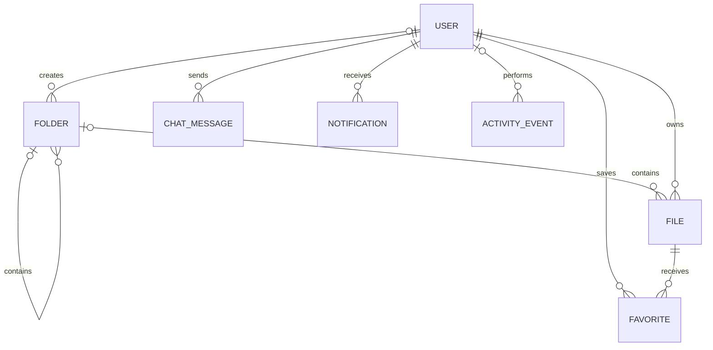
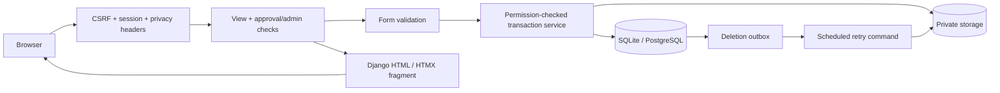

# WeFiles architecture

## Vertical slices and Django MVT

The repository and application root are both `WeFiles/`. Feature apps such as
`accounts/` sit beside `manage.py`, without a nested project wrapper.
The frontend remains server-rendered Django templates with HTMX and small
JavaScript enhancements. Styling currently uses Bootstrap and custom CSS;
Tailwind is an allowed styling alternative, independent of React. Keep React,
React DOM, SPA routers and a JavaScript application runtime out of the active
app. The original frontend in `legacy/` is reference material and is excluded from
the Docker image by `.dockerignore` and is not built by Django CI.

A slice is a business feature implemented as a Django app, owning its data,
request handling and presentation together. This keeps feature changes local
while using Django's standard model–view–template (MVT) architecture.

```text
WeFiles/
├── manage.py
├── config/                 Settings, root URLs and deployment entry points
├── accounts/               Identity, profiles, membership and administration
│   ├── models.py           User data and constraints (Model)
│   ├── views.py            HTTP orchestration and responses (View)
│   ├── templates/
│   │   └── accounts/       Pages, components, picker and registration/
│   ├── static/accounts/    Portrait source and profile enhancement
│   ├── templatetags/       Account presentation helpers
│   ├── forms.py            Validated inputs
│   ├── services.py         Permission-checked business operations
│   ├── urls.py             Authentication and own-account routes
│   ├── management_urls.py  Workspace administration routes
│   ├── migrations/         Existing migration history, preserved
│   ├── admin.py
│   ├── tests.py
│   └── tests_migrations.py
├── vault/                  File/folder data, search, sharing and cleanup
│   ├── {models,views,forms,services,selectors,urls,admin,tests}.py
│   ├── templates/vault/
│   ├── static/vault/
│   ├── migrations/
│   └── management/commands/
├── chat/                   Messages, history, sending and polling
│   ├── {models,views,forms,services,urls,admin,tests}.py
│   ├── templates/chat/
│   ├── static/chat/
│   └── migrations/
├── notifications/          Recipient-scoped updates and unread refresh
│   ├── {models,views,services,urls,admin,tests}.py
│   ├── templates/notifications/
│   ├── static/notifications/
│   └── migrations/
├── activity/               Audit data, recording and administrator history
│   ├── {models,views,services,urls,admin}.py
│   ├── templates/activity/
│   └── migrations/
├── core/                   Workspace overview and small shared primitives
│   ├── templates/core/
│   ├── tests/              Shared test fixtures and integration checks
│   └── ...                 Access helpers, headers, throttling and health
├── templates/              Shared shell/components and error pages only
├── static/                 Shared design system, icons and pinned vendors
├── scripts/
├── Dockerfile
├── compose.yaml
├── legacy/                     Original React/Supabase source
├── docs/                       Requirements, architecture and operations
└── .github/workflows/          Django CI
```

- **Model:** each feature's models and database constraints describe persisted
  data. Services implement transactional mutations; selectors encapsulate
  reusable queries when a feature needs them.
- **View:** each feature's views check access, validate forms, call its services
  and select a full-page template or HTMX fragment. Views use named URLs.
- **Template:** feature pages, fragments and presentation tags live with their
  owner. Namespaced static paths prevent collisions. Templates extend the shared
  shell, and feature scripts load on the pages that use them.

`config/urls.py` mounts feature URL modules rather than importing feature views.
All existing paths and reverse names remain unchanged. `accounts.User` keeps its
app label and migration history, so this layout change needs no schema or data
migration. A dashboard may compose read-only data from other features; mutations
go through the owning feature's services. Shared access rules and layout belong
in `core` and the central shell, rather than being duplicated in each slice.

For a new capability, extend its owning app across these MVT layers. Create a
new app for a distinct business capability; avoid project-wide `models/`,
`views/` or feature-template buckets.

## Model and app boundaries



`vault.StorageDeletionJob` is a durable outbox, independent of File foreign
keys. Deleted file metadata can disappear while its storage cleanup retries.
`core.RateLimitBucket` stores HMAC identities and time-window counters for
register/reset/resend/login/chat throttles. django-axes separately tracks failed
login attempts in the database. Sessions live in the database.

- `accounts.User` extends AbstractUser and uses email for sign-in. Role and
  approval status are explicit application fields; staff/superuser remain
  separate maintenance privileges. Email and username uniqueness are enforced
  case-insensitively by constraints. Passwords use Django's production hasher.
- `vault.Folder` is an adjacency tree with a nullable parent. Sibling/root
  constraints prevent ambiguous names; PROTECT prevents accidental destruction
  of nonempty trees. Renaming folders does not rewrite physical file keys.
- `vault.File` stores immutable bytes under randomized private keys and
  separately editable metadata. All downloads pass approval checks.
- Favorites and notifications are recipient/user scoped. Messages belong to a
  single shared room; their sender is always assigned by the server.
- Activity events store safe labels and UUID references. They do not contain
  file bytes, passwords, request bodies, or message bodies.

## Request and mutation flow



Views never accept ownership, sender, application role, or approval state from
ordinary profile/upload/message forms. Service functions independently check
access. List/search/export share one allowlisted selector. The templates work
with full-page form submissions; HTMX adds save toggles, unread updates, and
bounded chat refreshes. No public media route exists, including in development.

Folder mutations lock the tree in stable UUID order. Membership actions lock
approved admins before rechecking authority and updating a target. Unique and
check constraints remain the final guard against duplicate or invalid data.
Use PostgreSQL for concurrent production workloads; SQLite does not provide
equivalent row-lock semantics.

## Routes

| Routes | Views and permission |
| --- | --- |
| `/`, `/dashboard/` | Session-aware redirect; approved workspace overview. |
| `/accounts/register/`, `/accounts/login/`, `/accounts/logout/` | Registration/login, POST-only logout. |
| `/accounts/verify/<uid>/<token>/`, `/accounts/verification-sent/`, `/accounts/verification/resend/` | Read-only verification confirmation, POST consumption, resend/status guidance. |
| `/accounts/password-reset/`, `/accounts/password-reset/done/`, `/accounts/reset/<uid>/<token>/`, `/accounts/reset/done/` | Django recovery flow with generic confirmation. |
| `/accounts/password-change/`, `/accounts/password-change/done/` | Authenticated password change. |
| `/accounts/status/`, `/accounts/profile/`, `/accounts/delete/` | Own status/profile; password-confirmed erasure. |
| `/vault/`, `/vault/saved/`, `/vault/folders/<uuid>/` | Approved members; filtered/paginated file lists. |
| `/vault/folders/new/`, `/vault/upload/` | Approved creation forms. |
| `/vault/folders/<uuid>/edit/`, `/vault/folders/<uuid>/delete/` | Approved admin only; validated move/rename or empty-only deletion. |
| `/vault/files/<uuid>/`, `/vault/files/<uuid>/download/` | Approved metadata/private attachment. |
| `/vault/files/<uuid>/edit/`, `/vault/files/<uuid>/delete/` | Approved admin metadata mutation/deletion. |
| `/vault/files/<uuid>/save/` | Approved member; POST own favorite toggle. |
| `/vault/export.csv` | Approved member; same filters, streaming formula-safe metadata. |
| `/chat/`, `/chat/messages/`, `/chat/send/` | Approved; bounded history/polling and rate-limited POST. |
| `/notifications/`, `/notifications/unread/`, `/notifications/<uuid>/read/`, `/notifications/read-all/` | Own records only, including account updates for pending members. |
| `/manage/`, `/manage/members/`, `/manage/activity/` | Approved admin stats/list/history. |
| `/manage/members/<uuid>/status/` | Approved admin POST; no self status changes or superuser status edits. |
| `/manage/members/<uuid>/role/` | Approved admin POST; any workspace role, including own/superuser accounts; last-admin guard. |
| `/admin/` | Approved/verified maintenance staff; inspection and restricted user maintenance. |
| `/privacy/`, `/health/live/`, `/health/ready/` | Public privacy/minimal health responses. |

Files: 25 per page. Folders: 12 per page with independent `folder_page`.
Chat: latest 50 first, with explicit older/newer history. Ordinary vault
browsing shows immediate contents; searching from the root covers the shared
vault. Saved files cover the whole vault. Owner filter links are available in
desktop file rows. Sort inputs are allowlisted and all pagination retains
query parameters.

## UI decisions

The shared `base.html` provides navigation, feedback, themes, and account
actions. Tokens in `static/css/tokens.css` control both themes; Bootstrap
provides form/button foundations with custom workspace styling. The dashboard
puts shared work first and moves account metadata into settings. A dedicated
chat screen preserves room for files on mobile. Named confirmations explain
deletion consequences. Empty, no-results, pending, unverified, and error states
include next actions.

HTML/SVG decorative illustration and the icon sprite are repo-native; no
third-party image/font requests are required. Vendor licenses are retained.

### Supplied logo and brand palette

`static/brand/source.png` preserves the supplied logo. `brand/logo.svg` uses
the original bitmap in a tighter display viewport, with its white backing
intact. The reusable `components/brand.html` pairs it with the WeFiles wordmark
in public headers and workspace navigation. The same asset is the favicon,
in the shared public header and sidebar. No logo is redrawn.

The logo preserves its lime and green colors. The interface uses neutral
surfaces, deep green `#345F3C` actions in light mode and muted green actions
in dark mode. A small green navigation marker keeps the brand present without
large bright fills. Typography, tight radii and proportional portrait framing
remain consistent across both themes.

### Interface simplification

The workspace label, privacy chip, chat access chip and saved-file tip are
removed. The dashboard starts with compact totals, recent files and recent
messages; it no longer has a promotional banner or decorative grid. Headings
and empty states use short, direct labels. Sign-in is a single form.

Neutral surfaces, flat borders and plain outline icons replace green-washed
backgrounds, colored icon tiles and offset shadows. The logo keeps its original
colors; green actions and a small active-navigation accent carry the brand.
Saved files use a bookmark. Permission checks, status information, destructive
action explanations, keyboard labels and action feedback are unchanged.

### Editable workspace roles

The Members screen provides a role selector for every account, including the
signed-in administrator and maintenance superusers. Approved administrators
can promote members or demote administrators. Self-demotion redirects to the
overview, avoiding an administrator page that the user can no longer access.
At least one active, verified, approved workspace administrator must remain.

Workspace permissions depend on the saved `role`, rather than the Django
`is_superuser` flag. Changing a superuser's workspace role to Member therefore
removes workspace administration access immediately, while leaving its separate
Django maintenance privileges unchanged. Role/status changes remain validated,
transactional, audited and notified. The service reloads the actor's authority
to reject stale requests after demotion. Self approval changes and workspace
status edits for maintenance superusers remain unavailable.
